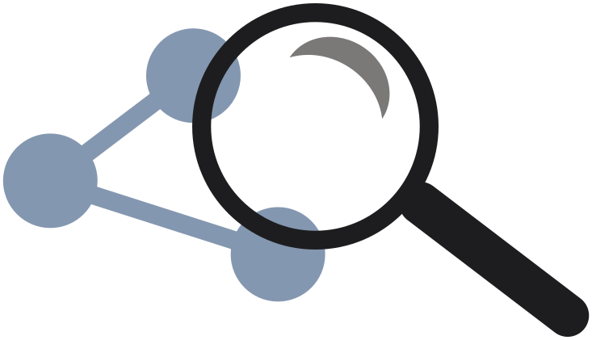
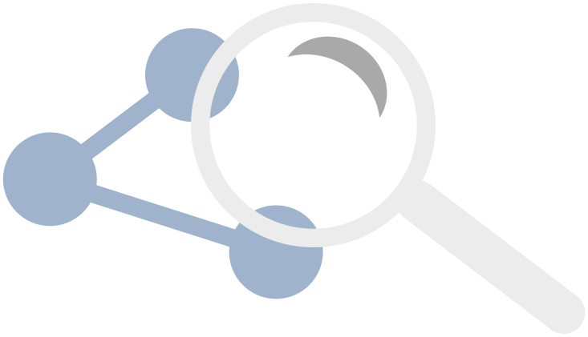
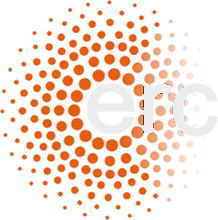

::: {.hero-banner}
::: {.content-block .py-4}
::: {.hero-text}

# Bayesian Graphical Modeling Lab {.mt-1}

### Bayesian methods for psychological networks

Psychologists use graphical models, or networks, to describe how symptoms, attitudes, and behaviours interact. The structure of such a network is unknown and has to be inferred from data, and with the data at hand we are rarely sure we have found the right one. The Bayesian approach makes that uncertainty explicit: it weighs the plausible network structures, quantifies the evidence for including or excluding each edge, and gives credible intervals for the network parameters.

The BGM Lab at the University of Amsterdam develops these methods and makes them available through open-access papers, open-source R packages, and [JASP](https://jasp-stats.org).

::: {.grid .gap-3 .pb-3 .pt-3}
::: {.g-col-12 .g-col-sm-4}
[Meet the team](team.qmd){.btn-action-primary .btn-action .btn .btn-lg .w-100 role="button"}
:::
::: {.g-col-12 .g-col-sm-4}
[Publications](publications.qmd){.btn-action .btn-secondary .btn .btn-lg .w-100 role="button"}
:::
::: {.g-col-12 .g-col-sm-4}
[Software](software.qmd){.btn-action .btn-secondary .btn .btn-lg .w-100 role="button"}
:::
:::

:::

::: {.hero-mark}
{.light-content fig-alt="Network with a magnifying glass, the BGM Lab logo"}
{.dark-content fig-alt="Network with a magnifying glass, the BGM Lab logo"}
:::
:::
:::

::: {.alt-background}
::: {.content-block .home-columns}

::: {.home-news}
## News

::: {#latest-news}
:::

[All news →](news.qmd){.section-link}
:::

::: {.home-pubs}
## Latest publications



[All publications →](publications.qmd){.section-link}
:::

:::
:::

::: {.content-block}
::: {.features}

::: {.feature}
### Software
Open-source R packages for Bayesian network analysis, including bgms, easybgm, and bvarnet, and point-and-click analyses in JASP.

[Software →](software.qmd)
:::

::: {.feature}
### Workshops
We teach Bayesian network analysis at summer and winter schools and conferences. Slides, R scripts, and exercises from past workshops are free to use.

[Workshops →](workshops.qmd)
:::

::: {.feature}
### Student projects
We offer thesis projects and internships for students who want to work on Bayesian methods, software, or applications.

[Projects →](projects.qmd)
:::

::: {.feature}
### Team
Researchers, PhD candidates, and collaborators working on Bayesian graphical models.

[Team →](team.qmd)
:::

:::
:::

::: {.alt-background}
::: {.content-block}

### Funding

::: {#grants}
:::

```{=html}
<div class="support-logos">



<p class="support-text">Supported by<br>ERC StG no. 101040876</p>
</div>
```

:::
:::
